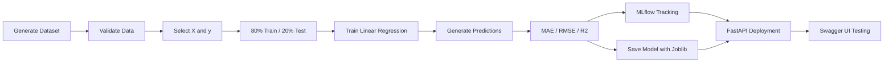
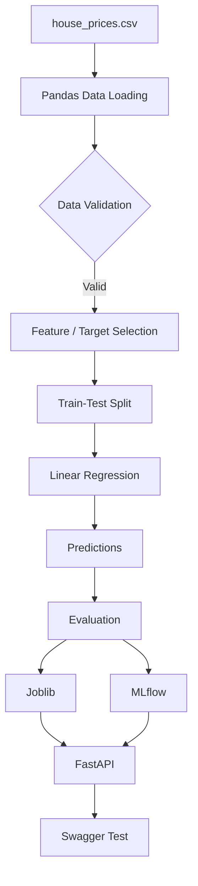

# House Price Prediction Using MLOps

An end-to-end Machine Learning project that predicts house prices from four input features and demonstrates a basic MLOps workflow using **Pandas, Scikit-learn, MLflow, Joblib, Git and FastAPI**.

## Project Objective

The model predicts a house price using:

- `area_sqft` - house area in square feet
- `bedrooms` - number of bedrooms
- `bathrooms` - number of bathrooms
- `house_age` - age of the house in years

The target variable is:

- `price` - house price in INR

## MLOps Workflow



## Project Structure

```text
house-price-prediction-mlops/
|
+-- data/
|   +-- house_prices.csv
|
+-- models/
|   +-- house_model.joblib
|
+-- generate_data.py
+-- train.py
+-- api.py
+-- requirements.txt
+-- .gitignore
+-- README.md
```

## 1. Dataset Preparation

The dataset is stored in `data/house_prices.csv`.

The five illustrative records supplied in the assignment are retained, and the program generates **995 additional synthetic records**, producing **1,000 records** in total.

The dataset contains:

| Column | Description |
|---|---|
| `area_sqft` | House area in square feet |
| `bedrooms` | Number of bedrooms |
| `bathrooms` | Number of bathrooms |
| `house_age` | Age of the house in years |
| `price` | House price in INR |

The dataset generation script also:

- displays the first five records;
- checks missing values;
- prints dataset statistics.

### Synthetic price logic

```python
price = (
    500000
    + 2800 * area_sqft
    + 250000 * bedrooms
    + 300000 * bathrooms
    - 40000 * house_age
    + noise
)
```

This is a synthetic relationship created for the practical exercise and is not a real-world property valuation formula.

## 2. Data Preprocessing

The model uses four independent variables and one target variable.

```python
FEATURES = [
    "area_sqft",
    "bedrooms",
    "bathrooms",
    "house_age"
]

TARGET = "price"

X = df[FEATURES]
y = df[TARGET]
```

The dataset is split into **80% training data** and **20% testing data**.

```python
X_train, X_test, y_train, y_test = train_test_split(
    X,
    y,
    test_size=0.20,
    random_state=10
)
```

For 1,000 records:

- Training records: **800**
- Testing records: **200**

## 3. Linear Regression Model

The model is created, trained and used for prediction as follows:

```python
model = LinearRegression()
model.fit(X_train, y_train)
predictions = model.predict(X_test)
```

## 4. Model Evaluation

The implementation calculates:

- **MAE** - Mean Absolute Error
- **RMSE** - Root Mean Squared Error
- **R2** - R-Squared Score

```python
mae = mean_absolute_error(y_test, predictions)
mse = mean_squared_error(y_test, predictions)
rmse = np.sqrt(mse)
r2 = r2_score(y_test, predictions)
```

### Result from the completed run

| Metric | Result |
|---|---:|
| MAE | INR 316,895.84 |
| RMSE | INR 402,549.35 |
| R2 | 0.9805 |

### Successful training pipeline


## 5. MLflow Experiment Tracking

The MLflow experiment is named:

```text
House Price Prediction
```

The training run records model configuration, dataset split information, evaluation metrics and the trained model artifact.

```python
mlflow.set_experiment(EXPERIMENT_NAME)

with mlflow.start_run(run_name="Linear_Regression_Run"):
    mlflow.log_param("model_type", "Linear Regression")
    mlflow.log_param("test_size", TEST_SIZE)
    mlflow.log_param("random_state", RANDOM_STATE)
    mlflow.log_param("total_records", len(df))
    mlflow.log_param("training_records", len(X_train))
    mlflow.log_param("testing_records", len(X_test))
    mlflow.log_param("feature_count", len(FEATURES))

    mlflow.log_metric("mae", mae)
    mlflow.log_metric("rmse", rmse)
    mlflow.log_metric("r2", r2)
```

### MLflow parameters and model artifact


### MLflow evaluation metrics


## 6. Model Persistence with Joblib

The trained model is stored in:

```text
models/house_model.joblib
```

```python
MODEL_PATH.parent.mkdir(
    parents=True,
    exist_ok=True
)

joblib.dump(model, MODEL_PATH)
```

Saving the model allows the API to reuse the trained model without retraining it for every prediction.

## 7. FastAPI Deployment

The saved model is loaded by the API:

```python
model = joblib.load(MODEL_PATH)
```

The API accepts:

```python
class HouseInput(BaseModel):
    area_sqft: float
    bedrooms: int
    bathrooms: int
    house_age: float
```

The prediction endpoint is:

```python
@app.post("/predict")
def predict(house: HouseInput):
    row = pd.DataFrame(
        [house.model_dump()],
        columns=FEATURES
    )

    prediction = float(model.predict(row)[0])

    return {
        "predicted_price": round(prediction, 2),
        "currency": "INR"
    }
```

## 8. Swagger UI Testing

The FastAPI application provides automatically generated Swagger documentation.

### Available API endpoints


### Prediction request


Example input:

```json
{
  "area_sqft": 1500,
  "bedrooms": 3,
  "bathrooms": 2,
  "house_age": 5
}
```

### Prediction response


The test returned an HTTP **200** response with a predicted house price.

## 9. Dependencies

The project uses:

```text
numpy
pandas
scikit-learn
mlflow
joblib
fastapi
uvicorn
```

Install all dependencies using:

```bash
python -m pip install -r requirements.txt
```

## 10. Running the Project

### Generate the dataset

```bash
python generate_data.py
```

### Train and evaluate the model

```bash
python train.py
```

### Start MLflow

```bash
mlflow ui
```

MLflow is available locally at:

```text
http://127.0.0.1:5000
```

### Start FastAPI

```bash
uvicorn api:app --reload
```

Swagger UI is available locally at:

```text
http://127.0.0.1:8000/docs
```

## Workflow Summary



## Conclusion

This project demonstrates a complete basic MLOps workflow:

**Data generation -> validation -> preprocessing -> model training -> evaluation -> experiment tracking -> model persistence -> API deployment -> API testing.**

The model achieved an R2 score of approximately **0.98** on the synthetic exercise dataset. Because the dataset is synthetic, the result demonstrates the workflow rather than real-world property valuation performance.
