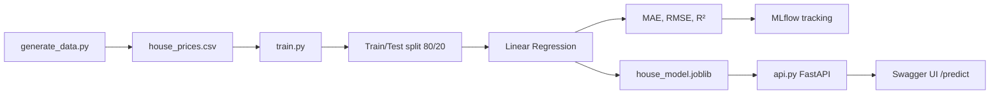

# 🏠 House Price Prediction using MLOps

A small end-to-end Machine Learning project that predicts the price of a house (in ₹) from its **area, bedrooms, bathrooms and age**. Besides training a model, the project shows a basic **MLOps workflow**: data preparation → training → evaluation → experiment tracking (MLflow) → model versioning (Joblib + Git) → deployment (FastAPI).

---

## 📌 Table of Contents
1. [Project Overview](#-project-overview)
2. [Tech Stack](#-tech-stack)
3. [Project Structure](#-project-structure)
4. [How the Project Works](#-how-the-project-works)
5. [Setup and Installation](#-setup-and-installation)
6. [Step-by-Step Usage](#-step-by-step-usage)
7. [Results and Screenshots](#-results-and-screenshots)
8. [API Reference](#-api-reference)
9. [Troubleshooting](#-troubleshooting)
10. [Future Improvements](#-future-improvements)

---

## 📖 Project Overview

| Item | Details |
|---|---|
| **Problem** | Predict house price from its features |
| **Type** | Supervised learning, regression |
| **Model** | Linear Regression (Scikit-learn) |
| **Target** | `price` (₹) |
| **Features** | `area_sqft`, `bedrooms`, `bathrooms`, `house_age` |
| **Tracking** | MLflow experiment: **House Price Prediction** |
| **Deployment** | FastAPI with Swagger UI |

---

## 🛠 Tech Stack

| Purpose | Tool |
|---|---|
| Language | Python 3 |
| Data handling | Pandas, NumPy |
| Machine Learning | Scikit-learn |
| Experiment tracking | MLflow |
| Model saving | Joblib |
| Version control | Git |
| API | FastAPI, Uvicorn |

---

## 📁 Project Structure

```
house-price-mlops/
│
├── data/
│   └── house_prices.csv        # Dataset (created by generate_data.py)
│
├── models/
│   └── house_model.joblib      # Trained model (created by train.py)
│
├── screenshots/                # Result screenshots used in this README
│
├── generate_data.py            # Creates the dataset
├── train.py                    # Preprocess, train, evaluate, track, save
├── api.py                      # FastAPI prediction service
├── requirements.txt            # Dependencies
├── .gitignore
└── README.md
```

---

## ⚙ How the Project Works



### 1. Dataset preparation (`generate_data.py`)
Creates `data/house_prices.csv` with **100 rows**: the 5 example records from the assignment plus 95 synthetic records. Prices are generated from a realistic rule (larger area, more bedrooms and bathrooms raise the price; older age lowers it) with some random noise.

| Column | Description |
|---|---|
| `area_sqft` | House area in square feet |
| `bedrooms` | Number of bedrooms |
| `bathrooms` | Number of bathrooms |
| `house_age` | Age of the house in years |
| `price` | House price in ₹ (target) |

### 2. Data preprocessing (`train.py`)
- Loads the CSV with Pandas, prints the first five records and checks for missing values (none found).
- **X** = `area_sqft`, `bedrooms`, `bathrooms`, `house_age`; **y** = `price`.
- Splits the data into **80% training (80 rows)** and **20% testing (20 rows)** with `random_state=42`.

### 3. Model development (`train.py`)
- Trains a **Linear Regression** model on the training data.
- Predicts prices for the test data.
- Evaluates with **MAE**, **RMSE** and **R²**.

### 4. Experiment tracking with MLflow
Each run of `train.py` logs to the experiment **House Price Prediction**:
- **Parameters:** `model_type`, `test_size`, `random_state`, `features`, `fit_intercept`
- **Metrics:** `MAE`, `RMSE`, `R2`
- **Artifacts:** the trained model

### 5. Model versioning
- The model is saved to `models/house_model.joblib` with **Joblib**.
- The code is tracked with **Git**.
- Dependencies are listed in `requirements.txt`.

### 6. Model deployment (`api.py`)
A **FastAPI** app loads the saved model and exposes a `/predict` endpoint. It takes house details as JSON and returns the predicted price. It can be tested through **Swagger UI**.

---

## 🚀 Setup and Installation

### 1. Clone or download the project
```bash
git clone <your-repository-url>
cd house-price-mlops
```

### 2. Create a virtual environment

**Windows (PowerShell)**
```powershell
python -m venv venv
venv\Scripts\Activate.ps1
```

**Windows (Command Prompt)**
```cmd
python -m venv venv
venv\Scripts\activate
```

**Linux / macOS**
```bash
python3 -m venv venv
source venv/bin/activate
```

### 3. Install dependencies
```bash
python -m pip install --upgrade pip
python -m pip install -r requirements.txt
```

---

## ▶ Step-by-Step Usage

### Step 1: Generate the dataset
```bash
python generate_data.py
```
Creates `data/house_prices.csv`.

### Step 2: Train the model
```bash
python train.py
```
This prints the first five records, missing values, the train/test sizes and the metrics, then logs the run to MLflow and saves `models/house_model.joblib`.

### Step 3: View experiments in MLflow
```bash
mlflow ui
```
Open **http://127.0.0.1:5000** and select the experiment **House Price Prediction**.

### Step 4: Start the API
Open a **new terminal**, activate the virtual environment, and run:
```bash
uvicorn api:app --reload
```
Open **http://127.0.0.1:8000/docs** for Swagger UI.

### Step 5: Test a prediction
In Swagger UI, open **POST /predict** → **Try it out** → enter the values → **Execute**.

---

## 📊 Results and Screenshots

### Model performance

| Metric | Value |
|---|---|
| **MAE** | ₹3,13,955.64 |
| **RMSE** | ₹4,11,529.55 |
| **R²** | 0.9806 |

An R² of about **0.98** means the model explains roughly 98% of the variation in house prices on the test data. The average error (MAE) is about ₹3.1 lakh, small compared with the average price of about ₹68 lakh.

> ⚠ The dataset is small and mostly synthetic, so these results are for learning purposes only.

### 1. Training output
Dataset preview, missing values check, train/test split, metrics and model saving.


### 2. Swagger UI
The FastAPI app with the `GET /` and `POST /predict` endpoints.


### 3. Prediction request
The input sent to `/predict`.


### 4. Prediction response
The API returns the predicted price with status **200**.


### 5. MLflow: metrics
The run in the experiment **House Price Prediction** with MAE, RMSE and R².


### 6. MLflow: parameters and logged model
Recorded parameters and the logged model artifact.


---

## 🔌 API Reference

### `GET /`
Health check.

```json
{"message": "House Price Prediction API is running. Open /docs for Swagger UI."}
```

### `POST /predict`
Predicts the price of a house.

**Request body**
```json
{
  "area_sqft": 1500,
  "bedrooms": 3,
  "bathrooms": 2,
  "house_age": 3
}
```

| Field | Type | Description |
|---|---|---|
| `area_sqft` | float (> 0) | Area in square feet |
| `bedrooms` | int (≥ 0) | Number of bedrooms |
| `bathrooms` | int (≥ 0) | Number of bathrooms |
| `house_age` | float (≥ 0) | Age of the house in years |

**Response**
```json
{
  "predicted_price": 6100560.35,
  "currency": "INR"
}
```

**Example with curl**
```bash
curl -X POST "http://127.0.0.1:8000/predict" \
  -H "Content-Type: application/json" \
  -d '{"area_sqft": 1500, "bedrooms": 3, "bathrooms": 2, "house_age": 3}'
```

---

## 🧰 Troubleshooting

| Problem | Solution |
|---|---|
| `Fatal error in launcher` when running `pip` | The venv was moved or copied. Delete the `venv` folder, create it again, and use `python -m pip install -r requirements.txt`. |
| PowerShell blocks `Activate.ps1` | Run `Set-ExecutionPolicy -Scope CurrentUser RemoteSigned`, then activate again. |
| `FileNotFoundError: house_model.joblib` | Run `python train.py` first. The API needs the saved model. |
| `FileNotFoundError: house_prices.csv` | Run `python generate_data.py` first. |
| Port already in use | Use another port, e.g. `uvicorn api:app --port 8001`. |
| `python` is not recognized | Try `py` instead of `python` on Windows. |

---

## 🔮 Future Improvements
- Use a larger real-world dataset and add features such as location.
- Try other models (Random Forest, Gradient Boosting) and compare them in MLflow.
- Add automated tests and a CI pipeline.
- Containerize the API with Docker.
- Register the model in the MLflow Model Registry.

---

## 📝 Notes
- `venv/`, `mlruns/` and `mlflow.db` are listed in `.gitignore` and are not committed.
- Run `generate_data.py` and `train.py` before starting the API.
